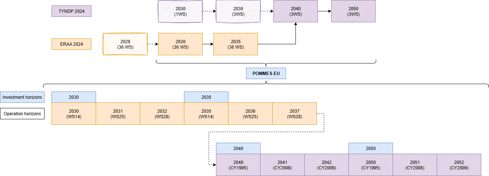

# POMMES-EU
This repository presents running code and input data for a European electricity and hydrogen model. It runs on [POMMES-KUL](https://github.com/qraillard/pommes-kuleuven), the KU Leuven version of [POMMES](https://git.persee.minesparis.psl.eu/energy-alternatives/pommes), an open source framework to model investment pathways in multi-energy systems.

The framework enables to minimise the system costs to meet the energy services demand by modelling the investment
and operating costs of energy conversion, storage and transport technologies.

## Model and data
POMMES-EU is based on data from [ERAA2024](https://www.entsoe.eu/eraa/2024/) and [TYNDP2024](https://www.entsoe.eu/outlooks/tyndp/2024/), integrating 35 countries (each represented by a single modeling node), four investment horizons, and three operational years—each corresponding to a distinct weather scenario—between each investment phase.


[CY=Climate Year, WS=Weather Scenario]

## Scenarios
The repository was developed to study electricity and hydrogen capacity expansion in production and storage technologies under different hydrogen infrastructure settings. The dataset includes 3 scenarios, each with its own configuration file:

| Scenario | Configuration file |
|---|---|
| ISO - Isolated Hydrogen Systems | `config.yaml` |
| EHB - European Hydrogen Backbone | `config_ehb.yaml` |
| EHB+I - European Hydrogen Backbone allowing for extra-european imports | `config_ehb+i.yaml` |


## Running a study
Install POMMES-KUL following [its instructions](https://github.com/qraillard/pommes-kuleuven#installation) and download the [input data](#input-data), then run from the root of this repository:

```bash
python run_study.py -c config_ehb.yaml -t 4
```

| Option | Effect |
|---|---|
| `-c <file>` | Configuration file (default `config.yaml`, i.e. the ISO scenario) |
| `-s <solver>` | Solver: `gurobi` (default), `cplex`, `highs`, ... |
| `-t <n>` | Number of threads (default 4) |
| `-n <n>` | Keep only the first `n` countries of the default list of 27 |
| `-m` | Hydrogen must-run setting |
| `-d` | Daily hydrogen demand |
| `-r <0\|1>` | Methane-based hydrogen ramping off/on (default `1`) |

`-m` and `-d` cannot be combined in a single run.

The default solver, Gurobi, is commercial (free academic licences are available). HiGHS is open source, but according to the authors it cannot solve this type of problem in a reasonable time.

## Input data
The inputs are semicolon-separated CSV files (about 3.5 GB in total, `availability.csv` alone is 2 GB), archived on Zenodo: [10.5281/zenodo.23662766](https://doi.org/10.5281/zenodo.23662766). They are listed in the configuration files and expected in `data/`. Download them with:

```bash
python fetch_data.py
```

The script only needs Python 3. It checks the MD5 checksum of every file, skips the files that are already present and resumes interrupted downloads. Use `--list` to list the files of the record and `--only <file> ...` to download only some of them.

## Citation
If you use this repository or its input data, please cite:

Hoogsteyn, A., Raillard-Cazanove, Q., Bruninx, K., & Delarue, E. (2026). [When hydrogen is not fully flexible: Implications for sector-coupled energy models](https://papers.ssrn.com/sol3/papers.cfm?abstract_id=7177068). Preprint.

The input data have their own DOI, see [Input data](#input-data). A [`CITATION.cff`](CITATION.cff) file is provided for GitHub's "Cite this repository" button.

## License
MIT, see [`LICENSE.txt`](LICENSE.txt). Contributors are listed in [`AUTHORS`](AUTHORS).
